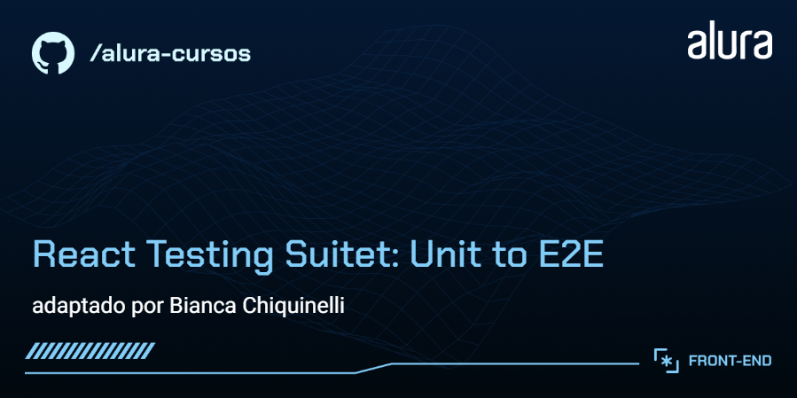
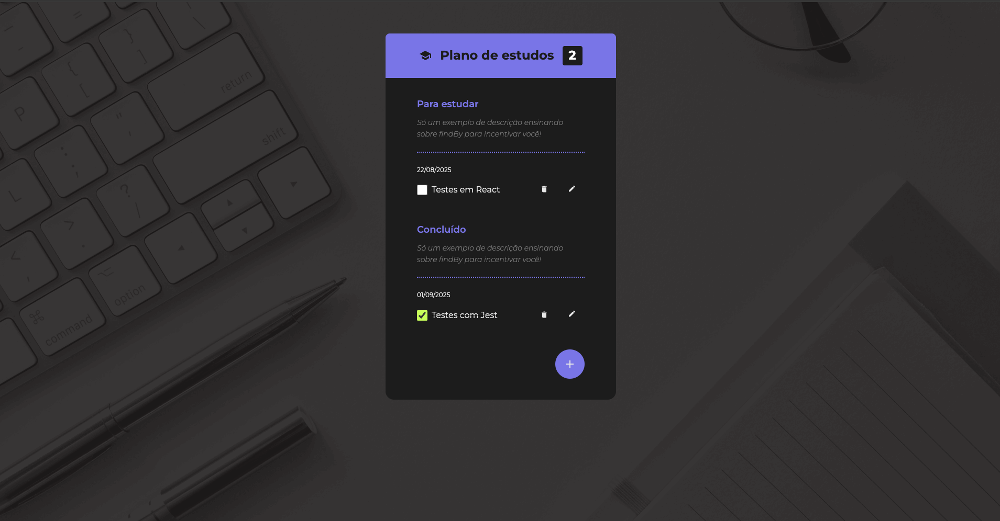

# 🧪 Checklist App — Suite Completa de Testes Automáticos (Jest, RTL & Cypress)



Aplicação React focada em garantir alta qualidade de software, confiabilidade e facilidade de manutenção por meio de uma estratégia completa de testes automatizados que cobre desde funções utilitárias isoladas até fluxos vitais End-to-End no navegador.

---

## 🎯 Destaques do Projeto & Engenharia de Testes

O diferencial deste repositório está na **cobertura abrangente em todas as camadas da Pirâmide de Testes**, adotando boas práticas e abstrações de teste para manutenibilidade:

- **Arquitetura & Custom Render:** Criação de um `customRender` que engloba contextos globais (`TodoContext`), eliminando boilerplate e simplificando asserções nos testes de componentes.
- **Simulação Realista do Usuário:** Utilização de `@testing-library/user-event` para simular interações reais de digitação e submissão de formulários, associado a _spies_ e _mocks_ de funções do contexto.
- **Testes Orientados a Dados (Data-Driven):** Testes unitários para funções utilitárias puras (como `mergeClass`), cobrindo múltiplas variações condicionais de estilo.
- **Asserções Assíncronas e Casos Limite:** Uso estratégico de consultas assíncronas (`findBy`, `queryByText`) para validar estados de carregamento, respostas da API, seletores do React Context e renders de lista vazia.
- **E2E Browser Automation (Cypress):** Testes de ponta a ponta configurados com `baseUrl` e _Cypress Studio_, validando o ciclo completo do CRUD (criação, edição e exclusão de tarefas no DOM).
- **Métricas de Cobertura & DX:** Scripts customizados para geração de relatórios de _code coverage_, linting integrado para Jest e ambiente Babel pré-configurado.



---

## 🛠️ Tecnologias & Ferramentas

- **Core:** React, Vite, JavaScript (ES6+), React Context API
- **Unit & Integration Testing:** Jest, React Testing Library (RTL), `@testing-library/user-event`
- **End-to-End (E2E):** Cypress
- **Tooling & DX:** Babel, ESLint, Coverage Reports

---

## 🧪 Estrutura e Escopo dos Testes

| Camada                            | Ferramenta      | Escopo / Funcionalidades Testadas                                                                                |
| :-------------------------------- | :-------------- | :--------------------------------------------------------------------------------------------------------------- |
| **Unitário (Utils & Components)** | Jest + RTL      | Funções puras (`mergeClass`), botões de ação (`FabButton`), cabeçalhos e estados de renderização inicial.        |
| **Integração (Context & Forms)**  | RTL + userEvent | Fluxos do `FormToDo`, componentes `ToDoGroup`, `ToDoItem`, `ToDoCount` e integração direta com o `TodoProvider`. |
| **End-to-End (E2E)**              | Cypress         | Fluxos completos de criação, edição e remoção de tarefas em ambiente de navegador real.                          |

---

## 🚀 Como Executar o Projeto Localmente

### Pré-requisitos

- **Node.js** (v18+ recomendado)
- **npm** ou **yarn**

### Passo a Passo

1. **Clone e instale as dependências:**
   ```bash
   git clone [https://github.com/chiquinelli-bia/tests-jest-testing-library.git](https://github.com/chiquinelli-bia/tests-jest-testing-library.git)
   cd nome-do-repositorio
   npm install
   ```
2. **Execute a aplicação:**

   ```bash
    npm start
   ```

3. Execute a suíte de testes:

- Testes Unitários / Integração (Jest):

  ```bash
  npm test
  ```

- Relatório de Cobertura (Coverage):

  ```bash
  npm run test:coverage
  ```

- Testes End-to-End (Cypress):

  ```bash
  npx cypress open
  ```
